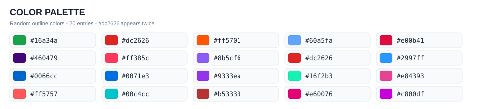

# 嘉立创 EDA 原理图布局 Skill

**版本：v2.1.0** · **用途：面向 AI Agent 的嘉立创 EDA 原理图空间规划、分区布局与终检辅助技能**

先确认图幅，再预演空间；先完成器件与电气连线，最后绘制分区框。空间不足时优先增加页面，而不是牺牲原理图可读性。

<p align="center">
  
  
  
  
  
  
</p>

<p align="center">
  
</p>


[工作流](#工作流) · [快速开始](#快速开始) · [项目结构](#项目结构) · [审阅规则](#参考原理图审阅规则) · [终检范围](#终检与验收) · [限制说明](#重要说明)

---

## 它解决什么问题

原理图自动排版很容易出现“所有器件都放进去了，但人无法快速读懂”的情况。本 Skill 将布局顺序、空间预演和交付检查转化为可重复执行的规则，并提供两个 Python 辅助脚本。

| 常见问题 | 本 Skill 的处理方式 |
| --- | --- |
| 不确定当前页面是 A4、A5 还是 A3 | 先读取并确认当前页面图幅、方向、安全区与标题栏禁布区；未确认前不修改图纸。 |
| 器件被挤在一页，标签和引脚难以辨认 | 先估算模块、器件包围盒、端口文字和布线空间；无法清楚排布时规划新增页。 |
| 边放元件边画分区框，最后框线压住内容 | 预演阶段只记录规划坐标；器件和电气连线完成后，按实际占用范围重算并绘制分区框。 |
| 原理图位号与 BOM 不一致 | 对 BOM 与原理图位号进行精确集合核对，检查重复、缺失、额外位号；例外必须显式登记。 |
| 跨区长导线穿过其他功能模块 | 同区使用局部连线；跨区/跨页优先使用同名 Port 或 Flag，并要求后续用网表/ERC 核实。 |
| 所有功能框都使用同一种颜色 | 从指定调色板随机分配描边色，尽量避免相邻分区颜色重复。 |
| 只看截图就判断电路是否正确 | 把“截图可见的布局事实”与“需要工程数据验证的电气事实”分开记录。 |

## 核心原则

1. **先确认图幅，再改图。** 未经用户确认，不移动/放置元件、不改线、不增删图元。
2. **先预演空间，不提前绘制可见框线。** 规划坐标不是最终分区框坐标。
3. **器件与连线完成后，再根据真实包围盒绘制分区框和标题。** 框线不能覆盖器件、网络标签或标题栏。
4. **可读性优先。** 不靠缩小器件符号、隐藏标签或挤压间距强行实现单页。
5. **位号必须与指定版本 BOM 对齐。** DNP/不装配等例外必须有明确清单。
6. **脚本 PASS 不等于电气验收通过。** 仍须在嘉立创 EDA 中检查 ERC、网表连通性并复核实际页面。

## 工作流

```text
S0 确认图幅与安全区
        ↓
S1 读取 BOM、位号与功能分组
        ↓
S2 空间预演，估算页数与模块位置
        ↓
S3 放置器件并核对器件包围盒
        ↓
S4 完成同区连线与跨区/跨页 Port/Flag
        ↓
S5 按真实占用范围绘制分区框和标题
        ↓
S6 运行终检门禁，并在 EDA 中完成 ERC/网表/截图复核
```

如果布局预演发现可读性不足或空间不足，应在实际绘制分区框之前重新分配模块、增加页面，或与用户确认更大图幅。

## 快速开始

### 1. 获取文件

将本仓库克隆到本地，或下载 ZIP：

```bash
git clone <你的仓库地址>
cd <仓库目录>
python --version
```

脚本仅使用 Python 标准库，无需安装第三方 Python 包。建议使用 Python 3.9 或更新版本。

### 2. 运行空间预演

仓库提供 `examples/layout_plan.example.json` 作为输入示例：

```bash
python scripts/layout_planner.py examples/layout_plan.example.json -o layout_preview.json
```

查看 `layout_preview.json` 中的：

- `decision.page_count`：规划所需页数；
- `decision.requires_additional_pages`：是否需要新增页面；
- `pages[].regions`：每页模块的预演坐标和随机描边色；
- `planning_only`：说明输出仅用于规划，不应直接视作最终框线坐标。

若 `requires_additional_pages` 为 `true`，请按预演结果分配模块到多个页面。器件和连线完成后，必须根据 EDA 返回的真实包围盒重新计算最终分区框。

### 3. 运行终检门禁

```bash
python scripts/check_overlap.py examples/project_gate.example.json
```

退出码：

| 退出码 | 含义 |
| --- | --- |
| `0` | 检查器门禁通过；仍需完成真实 EDA 电气验收。 |
| `1` | 检查发现违规，需要修复输入数据或布局。 |
| `2` | 输入格式错误或检查器执行异常。 |

`examples/project_gate.example.json` 是展示输入字段结构的最小示例，不是任何实际电路项目的验收记录。接入真实工程时，应使用从当前 EDA 页面、BOM 和网表取得的数据替换示例内容。

## 项目结构

```text
.
├── SKILL.md
├── README.md
├── CHANGELOG.md
├── scripts/
│   ├── layout_planner.py
│   └── check_overlap.py
├── docs/
│   ├── assets/
│   │   ├── skill-workflow.svg
│   │   └── color-palette.svg
│   ├── a3-coordinate-system.md
│   ├── port-routing-rules.md
│   └── reference-schematic-review.md
└── examples/
    ├── layout_plan.example.json
    └── project_gate.example.json
```

| 文件 | 用途 |
| --- | --- |
| `SKILL.md` | Skill 元数据、S0–S6 工作流、强制门禁和参考原理图审阅要点。 |
| `scripts/layout_planner.py` | 根据模块估算宽高做空间预演，规划坐标、页数与随机颜色；不会在 EDA 中绘图。 |
| `scripts/check_overlap.py` | 根据规范化的项目 JSON 检查分区重叠、器件边界/间距、标题边界、颜色、位号集合和跨区/跨页连接方式。 |
| `docs/a3-coordinate-system.md` | 已校准 A3 模板坐标、A4/A5 校准要求与标题锚点规则。 |
| `docs/port-routing-rules.md` | 跨功能区和跨页信号使用 Port/Flag 的规则。 |
| `docs/reference-schematic-review.md` | 从人工绘制的参考截图提炼的可复用审图清单。 |
| `examples/*.json` | 辅助脚本的输入结构示例。 |
| `CHANGELOG.md` | 版本变更记录。 |

## 参考原理图审阅规则

本 Skill 将参考截图中的布局观察转成后续项目可复用的审图步骤。它们是布局与可读性建议，不代表已经验证了电路功能。

### 优先检查项

- **USB-C 与电源链路：** 按输入、输入保护、充电管理、电池相关节点、电源转换与输出电源的逻辑组织模块，避免长线穿过无关区域。
- **MCU 与 I/O 映射：** 检查主控周围器件、引脚名、网络标签和 I/O 列表是否过密；必要时分区或拆页。
- **EPD 等高引脚数接口：** 为连接器、引脚号、标签与扇出预留空间；按电源、SPI、控制和状态信号进行可读分组。
- **KEY / KEY-RST / KEY-ADC：** 先确认真实功能，再统一标题和命名；不能只凭名称相似而合并电路。
- **32.768 kHz 时钟：** 将晶体及相关连接作为局部模块审阅；实际连接与负载参数必须从工程数据核实。
- **Micro SD：** 检查卡座、辅助器件、SPI/控制信号的标签是否一致，不能猜测截图中不可见的连接。
- **MIC 等模拟信号：** 清晰标注输入、偏置/供电和输出网络；原理图视觉分区不能证明 PCB 已实现噪声隔离。
- **标题和阅读方向：** 统一标题语言、字号、内边距与模块排列方向；框线和文字不能覆盖网络标签或连接信息。

审阅报告至少区分：**截图可见事实、布局建议、待网表/BOM/ERC 验证项、布局变更的影响**。完整规则见 [`docs/reference-schematic-review.md`](docs/reference-schematic-review.md)。

## 图幅与空间规则

- 目前只有特定模板的 **A3** 坐标经过校准：安全区 `x=40..1615, y=200..1145`；标题栏禁布区 `x=945..1645, y=7..190`。
- **A4/A5 不得按比例猜测或直接缩放 A3 坐标。** 必须从当前 EDA 页面属性/边框读取或校准安全区和标题栏区域，确认后才能执行预演。
- 功能区之间默认至少保留 `50 units`，同区器件之间默认至少 `20 units`；IC/连接器附近还需预留标签与扇出空间。具体值应根据模板坐标和器件真实包围盒评估。
- 嘉立创 EDA 文本标题坐标采用项目实测约定：`(x, y)` 是文字左下角。建议 `x_title = x_min + 10`，`y_title = y_max - (font_size + 10)`；24 号字对应 `y_max - 34`。执行前须确认当前 EDA API 的参数约定与返回坐标一致。

## 随机分区框颜色

每次生成分区框，从以下颜色池随机分配，并尽量避免相邻功能区同色：

<p align="center">
  
</p>

颜色池中的 `#dc2626` 按指定列表保留两次。颜色仅用于视觉分组，不代表电压等级、网络类型或电气属性。

## 终检与验收

终检脚本使用从 EDA、BOM 和网表整理得到的 JSON，不会自行读取或修改嘉立创 EDA 工程。它可检查：

- 图幅是否明确、每页安全区是否有效；
- 功能分区之间是否重叠，是否越出安全区或进入标题栏禁布区；
- 器件是否位于所属区域、器件包围盒间距是否符合阈值；
- 标题文本是否完整位于分区内；
- 分区描边颜色是否属于指定颜色池；
- BOM 位号与原理图位号是否精确匹配，是否存在重复、缺失或额外位号；
- 跨区/跨页信号是否登记为 Port 或 Flag；
- 是否标记图幅确认、器件放置、连线完成，以及分区框在连线后绘制。

终检失败时，按报告中的页码、模块名、位号和坐标修复后重新运行。最终交付还必须完成以下人工/EDA 检查：

1. 在实际嘉立创 EDA 环境确认目标页 UUID，避免跨页误删或误改；
2. 检查 ERC、网表连通性、关键电源/地、复位、时钟、SPI/I²C 和接口信号；
3. 在嘉立创 EDA 前台复核完整页面截图，确认框线和标题没有遮挡；
4. 若进行过移动、改线或加页，重新检查位号、连通性及页面完整性。

## 在 AI Agent 中使用

将仓库中的 `SKILL.md` 作为项目 Skill 或提供给所用 Agent 的技能加载器。具体安装目录与激活方式因 Agent/运行环境而异，请遵循对应环境的 Skill 管理方式。建议保持 `SKILL.md`、`scripts/`、`docs/` 和 `examples/` 的相对路径不变，以便主技能能够引用配套规则与脚本。

**执行图纸修改前的停等要求：** Agent 应先报告识别出的图幅并等待用户确认。不得因为文件名、旧会话记录或截图上看起来像 A4 就跳过当前页面属性核对。

## 重要说明

- 本仓库是 **Skill 规范与 Python 辅助脚本**，不是嘉立创 EDA 官方插件，也不包含自动连接 EDA API 的通用适配层。
- 脚本输入需由 Agent、EDA API 适配代码或人工整理成 JSON；脚本不会自行提取 BOM/网表，也不会实际放置器件、连线或绘制图元。
- 空间预演的坐标来自用户/工具提供的尺寸估算；真实绘图前必须用 EDA 返回的包围盒、页面 UUID 与当前模板坐标重新核对。
- `PASS` 只代表输入数据通过脚本所覆盖的结构化门禁，不表示 ERC、网表、电气规则、PCB 布局或硬件功能已经通过验证。
- 具体 API 行为可能随嘉立创 EDA 版本变化。涉及图元创建、页面切换和跨区连接的操作，应先做小规模验证，并在执行后检查实际结果。

## 版本记录

### v2.1.0

- 将参考人工原理图的审阅建议沉淀为独立文档和主 Skill 中的通用规则。
- 纳入 MCU/I/O 密集区、EPD 高引脚数接口、电源阅读路径、按键命名、32.768 kHz 时钟、Micro SD 与模拟信号的审图关注点。
- 明确区分截图可见的布局事实与需要 BOM、网表、器件数据手册或 ERC 验证的电气结论。

### v2.0.0

- 强制确认图幅，禁止未经校准将 A3 坐标按比例换算为 A4/A5。
- 调整顺序为：空间预演 → 器件放置 → 完成连线 → 绘制可见分区框 → 终检。
- 增加加页规划、随机分区颜色、BOM 位号核对与更多终检门禁。

---

如需扩展，可优先增加特定嘉立创 EDA 版本的 API 适配层，以及从实际工程自动导出 BOM/网表和包围盒的工具；在这些接口尚未接入前，应持续将数据来源与验证状态显式记录。
